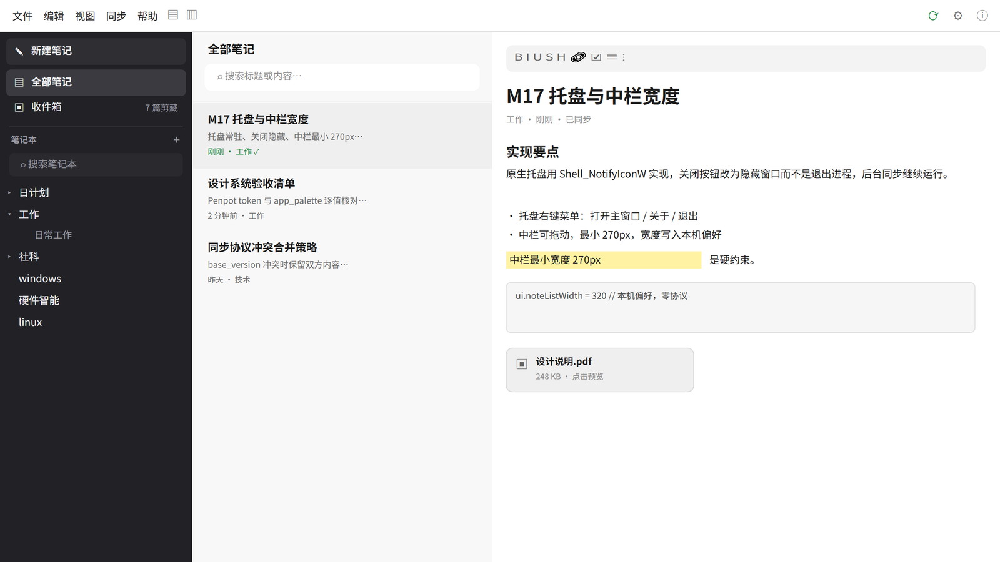
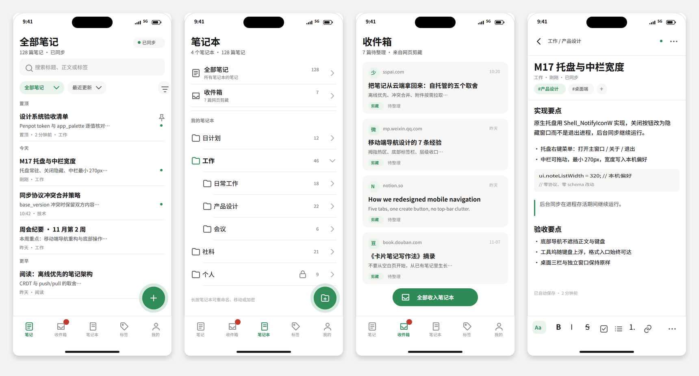

<p align="center">
  
</p>

# 随手记 Sui

**印象笔记替代品 —— 自托管 · 离线优先 · 多端同步的现代 Markdown 笔记应用。**

> 项目英文名：**Sui**（音近「随手」）

笔记以 **Markdown 为唯一正本**，本地 SQLite 离线读写，自托管 Go 服务端负责多端同步；
支持网页剪藏、版本历史、附件管理与批量导入，**数据完全由你自己掌控**。

## 界面预览

**桌面端**（Windows / macOS / Linux）—— 笔记本 / 笔记列表 / 编辑器三栏，窄屏自动收敛为底部导航：



**移动端**（Android / iOS）—— 底部五标签、编辑页工具坞：



> 以上为 Penpot 设计稿导出（桌面 `ED-01`，移动 `MB-01` / `MB-02` / `MB-04` / `MB-06`），不是真机截图。

## 核心特性

### 写作与编辑

- **Markdown 唯一正本**：「格式 / 源码 / 预览」三态编辑，格式模式所见即所得并即时回写，不引入富文本中间态。
- **就地格式化**：表格工具、粘贴保留格式、简化格式、任务勾选、`==高亮==`、围栏代码块、有序列表自动续号。
- **高频动作顺手**：正文右键菜单、列表 `Tab` / `Shift+Tab` 缩进、笔记内查找替换、关联笔记跳转、链接可点击。
- **专注写作**：独立笔记窗口、笔记属性面板、桌面端面板折叠与自绘菜单栏、托盘常驻与单实例唤起。
- **外观**：主题三态（亮 / 暗 / 跟随系统）、界面字体与正文字体独立可调，每个笔记本可覆盖正文字体。

### 组织与检索

- **笔记本 + 标签**：嵌套笔记本、多对多标签，收件箱 / 归档 / 回收站三态收口。
- **关键字搜索**：标题与正文子串匹配（`LIKE`，非 FTS5）。
- **版本历史**：每条修订可查看、可一键恢复，历史永不重写。

### 同步与离线

- **离线优先**：断网照常读写，联网自动同步（编辑防抖 0.7s 推送 + WebSocket 通知 + 30s 周期兜底）。
- **绝不丢字**：自研 push/pull + `base_version` 冲突检测 + 启发式合并，冲突双方内容都保留。
- **逐项可见**：每篇笔记 / 笔记本 / 标签均有本地同步状态（已同步 / 待上传 / 仅本地 / 冲突 / 失败），
  可单项「立即上传 / 重试」，也可一键「全部重新同步」。
- **可自愈**：换服务端或重建库后，按云端权威态核对补齐，或按提示决断保留哪一端。

### 内容与附件

- **内容寻址附件**：sha256 去重与校验，映射全量同步、字节按需拉取 + LRU 缓存；内置预览 + 外部编辑回写。
- **大附件**：过 16 MiB 分片断点续传、过 100 MiB 流式读盘，单附件上限 512 MiB。
- **网页剪藏**：Chrome MV3 扩展，智能提取正文 / 全页快照 / 选区剪藏，图片本地化，原页下线仍可读。
- **批量导入**：`.md` / `.txt` / `.html`（含印象笔记「导出为 HTML」）一次导入当前笔记本，全程离线。
- **数据导出**：一键把 Markdown 原文复制到剪贴板。

### 安全与部署

- **认证**：30 分钟访问令牌 + 30 天可撤销刷新令牌（单次使用、轮换、重放即吊销）。
- **受保护通道**：`http://` 下 X25519 + TOFU 指纹 + 逐请求 AES-256-GCM。
- **加密笔记本**：Argon2id 派生密钥、只驻内存，服务端只搬密文。
- **自托管**：单二进制 Go 服务端，SQLite 元数据 + 本地磁盘 Blob，可选 S3 / MinIO / R2 后端。

## 技术栈

| 层级 | 技术 |
|------|------|
| 客户端 | Flutter（Android / iOS / Windows / macOS / Linux / Web） |
| 状态管理 | Provider（单一状态源 `AppController`） |
| 本地存储 | SQLite（drift，`schemaVersion = 10`） |
| 服务端 | Go（标准库 `net/http`），单二进制自托管 |
| 服务端存储 | SQLite 元数据 + 本地磁盘 Blob（sha256 分片），可选 S3 兼容后端 |
| 同步协议 | 自研 push/pull + `base_version` 冲突检测 + 启发式合并 |
| 剪藏净化 | 类 Readability 启发式 + HTML→Markdown 转换器 |
| 浏览器扩展 | Chrome Extension Manifest V3 |
| 实时通知 | WebSocket（`nhooyr.io/websocket`） |

## 项目结构（monorepo）

```
sui/
├── README.md  LICENSE  CONTRIBUTING.md  CHANGELOG.md    # 根级：社区/协作文件（全大写）
├── CODE_OF_CONDUCT.md  SECURITY.md  DEVELOPMENT.md  ARCHITECTURE.md
├── docs/                    # 文档中心（入口：docs/index.md）
│   ├── index.md             # 文档索引
│   ├── getting-started.md   # 环境搭建 / 构建测试 / 快速开始
│   ├── architecture.md      # 系统架构 / 数据模型 / 同步协议
│   ├── api-reference.md     # HTTP API 参考
│   ├── deployment.md        # 部署与生产化
│   ├── troubleshooting.md   # 故障排查
│   ├── guides/              # 用户指南
│   └── examples/            # 代码示例
├── server/                  # Go 同步服务端（自托管友好）
│   ├── cmd/sui-server/      # 服务端入口
│   └── internal/            # api / auth / blob / clip / cors / store / sync / ws 等
├── clients/
│   ├── note_core/           # 多端共享核心逻辑（纯 Dart：模型 / 本地库 / 同步引擎）
│   └── flutter_app/         # Flutter 多端客户端
├── extension/               # Chrome 剪藏扩展（Manifest V3）
└── Makefile                 # 顶层构建工具
```

## 快速开始

### 1. 启动服务端

```bash
cd server
go build -o bin/sui-server ./cmd/sui-server
./bin/sui-server            # 默认监听 :8080，数据目录 ./data
```

可通过环境变量覆盖：`SUI_ADDR`（监听地址，默认 `:8080`）、`SUI_DATA`（数据目录，默认 `./data`）。

验证：

```bash
curl http://localhost:8080/healthz
curl http://localhost:8080/api/v1/ping
```

### 2. 注册账号获取 Token

```bash
curl -X POST http://localhost:8080/api/v1/register \
  -H "Content-Type: application/json" \
  -d '{"username":"me","password":"secret"}'
# → {"ok":true,"token":"...","username":"me"}
```

### 3. 运行客户端

```bash
cd clients/flutter_app
flutter run -d chrome    # Web（本机已验证可运行）
```

客户端**不预设服务端地址**：首次使用点顶栏「同步设置」，填入地址（如
`http://127.0.0.1:8080`）并用上一步拿到的账号「注册并连接」或「登录并连接」，
配置会存入本地库，之后自动防抖同步。

### 4. 安装剪藏扩展

1. 打开 Chrome → `chrome://extensions` → 开启「开发者模式」
2. 「加载已解压的扩展程序」→ 选择 `extension/` 目录
3. 点击扩展图标 → 右键「选项」→ 填入服务端地址与 Token

> 详细步骤与各平台构建说明见 [docs/getting-started.md](docs/getting-started.md)。

## 文档导航

| 文档 | 内容 |
|------|------|
| [📚 文档中心](docs/index.md) | 全部文档的索引入口 |
| [🚀 快速开始](docs/getting-started.md) | 环境搭建、构建测试、端到端验证 |
| [🏛 系统架构](docs/architecture.md) | 分层设计、数据模型、同步协议 |
| [🔌 API 参考](docs/api-reference.md) | HTTP 接口与载荷示例 |
| [📦 部署指南](docs/deployment.md) | 生产部署、反代、备份、安全加固 |
| [🧭 故障排查](docs/troubleshooting.md) | 常见问题与已知坑 |
| [📖 用户指南](docs/guides/user-guide.md) | 客户端日常使用 |
| [🧩 网页剪藏](docs/guides/web-clipper.md) | 浏览器扩展使用 |
| [🛠 开发指南](DEVELOPMENT.md) | 开发者根级入口 |
| [🏗 架构总览](ARCHITECTURE.md) | 架构根级入口 |

> 架构决策记录（ADR）随项目技术文档单独维护，**不随本仓库发布**。

## 里程碑

里程碑号 = 次版本号（`M22` ↔ `v0.22.0`）；里程碑内的问题按补丁号迭代，不再新增里程碑。
**逐版本变更见 [CHANGELOG.md](CHANGELOG.md)**，下表只留版本级要点。

| 里程碑 | 版本 | 主题 | 补丁 |
|--------|------|------|------|
| M0 | `v0.1.0` | 框架与基本功能（工程骨架、本地 CRUD、多端同步、修订历史、剪藏基线） | — |
| M1 | `v0.2.0` | 笔记本分组与标签的云端同步 | — |
| M2 | `v0.3.0` | 整理体验与格式化编辑 | — |
| M4 | `v0.5.0` | 单用户服务化与安全加固 | — |
| M5 | `v0.6.0` | 编辑器交互与呈现增强 | — |
| M6 | `v0.7.0` | 全页快照与离线自持剪藏 | `v0.7.1` |
| M7 | `v0.8.0` | 桌面端界面布局优化（面板折叠 + 自绘菜单栏） | `v0.8.1`~`v0.8.3` |
| M8 | `v0.9.0` | 桌面端独立笔记窗口 | `v0.9.1` |
| M9 | `v0.10.0` | 编辑器编辑能力与附件体验增强 | `v0.10.1` / `v0.10.13` / `v0.10.14` |
| M10 | `v0.11.0` | 认证与笔记安全加固（刷新令牌 / 受保护通道 / 加密笔记本） | `v0.11.1`~`v0.11.3` |
| M12 | `v0.12.0` | 逐项同步状态与云端核对补齐 | `v0.12.1`~`v0.12.2` |
| M13 | `v0.13.0` | 批量导入本地文件到笔记本 | `v0.13.1`~`v0.13.5` |
| M14 | `v0.14.0` | 客户端设置与外观（设置中心 / 主题三态 / 字体） | `v0.14.1`~`v0.14.3` |
| M15 | `v0.15.0` | 笔记编辑体验增强（查找替换 / 属性 / 关联笔记 / 围栏块） | — |
| M16 | `v0.16.0` | 网页剪藏保真与笔记本组织（网页原件 / 选区剪藏） | `v0.16.1`~`v0.16.5` |
| M17 | `v0.17.0` | Windows 后台常驻与中栏宽度调节 | `v0.17.1`~`v0.17.3` |
| M18 | `v0.18.0` | 编辑器右键菜单、列表 Tab 缩进与左栏对齐 | `v0.18.1`~`v0.18.2` |
| M19 | `v0.19.0` | 移动端底部导航与编辑工具坞 | `v0.19.1`~`v0.19.3` |
| M20 | `v0.20.0` | 大附件分片断点续传（上限 512 MiB） | — |
| M21 | `v0.21.0` | 大附件流式读盘 | — |
| M22 | `v0.22.0` | S3 兼容附件存储后端 | `v0.22.1`~`v0.22.4` |

> **编号空档**：M3 / `v0.4.0` 未编码即被 M4 插队、永久留空；M11 为让里程碑号与版本号对齐而有意留空。

## 贡献

欢迎参与贡献！请先阅读 [CONTRIBUTING.md](CONTRIBUTING.md) 与
[CODE_OF_CONDUCT.md](CODE_OF_CONDUCT.md)。安全问题请按 [SECURITY.md](SECURITY.md) 上报。

## 许可证

本项目基于 [MIT License](LICENSE) 开源。
